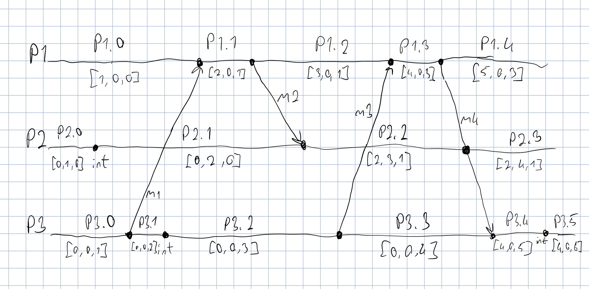

# BRAINSTORM - CMPE436 Clocks HW (2021400162)

## Q1 - clocks by hand

**Slides read:** Lecture 5-2 slides 13-15 (happened-before), 17-20 (Lamport clock, total order), 21-25 (vector clocks), 26-28 (direct-dependency clocks), and the "Traces and clock conventions" part of the handout.

**Idea in my own words:**
Q1 checks if I can run the three slide algorithms by hand on my trace and use them to decide happened-before. Lamport gives one number per state and only guarantees s -> t implies L(s) < L(t). The vector clock keeps one counter per process, so comparing vectors tells exactly if two states are ordered or concurrent. The direct-dependency clock only sends the sender's own entry, so it only sees paths with at most one message. The tricky part is the convention: a message carries the value of the state *before* the send.

**My trace:** 3 processes, 12 events, states P1.0-P1.4, P2.0-P2.3, P3.0-P3.5. Messages leave from m1: P3.0, m2: P1.1, m3: P3.2, m4: P1.3. P2 never sends, so no P2 state can happen before a P1 or P3 state.

**Plan:**
1. Draw the space-time diagram on paper with the state names between events.
2. Go down the trace line by line: Lamport, then vector, then direct-dependency clocks.
3. (d): s -> t iff V(s) < V(t). (e): L smaller but vectors not comparable. (f): look where D and V differ.
4. Check again later with P1.

**My space-time diagram** (vector clock written under each state):

**Ideas I dropped:**
- Doing (d) only by following arrows on the diagram: it is easy to start from the wrong side of a send, comparing vectors is mechanical.
- Labeling events like the textbook version (the send increments first and the message carries the new value). It does not match the handout table (the slide 23 example would give P3.1 = 5, not 3).

**Notes while doing Q1:**
- D and V only differ at P2.2 and P2.3 (D has 0 for P3): P2 hears about P3.0 only through P1, which forwards only its own entry. So (f) = P3.0 P2.2.
- rel.2 (P1.2 vs P2.2) is `||`, because m2 leaves from P1.1, not P1.2.
- (e) = P2.3 P3.5 (L=4 < 6), nothing on P2 can be before P3.5.
- The own entry of D is always equal to L. Good check for my numbers.
